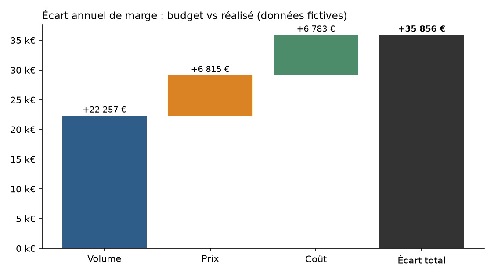
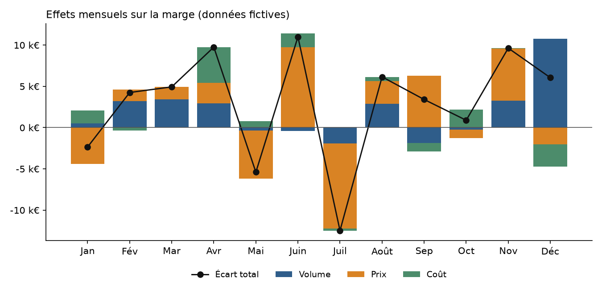
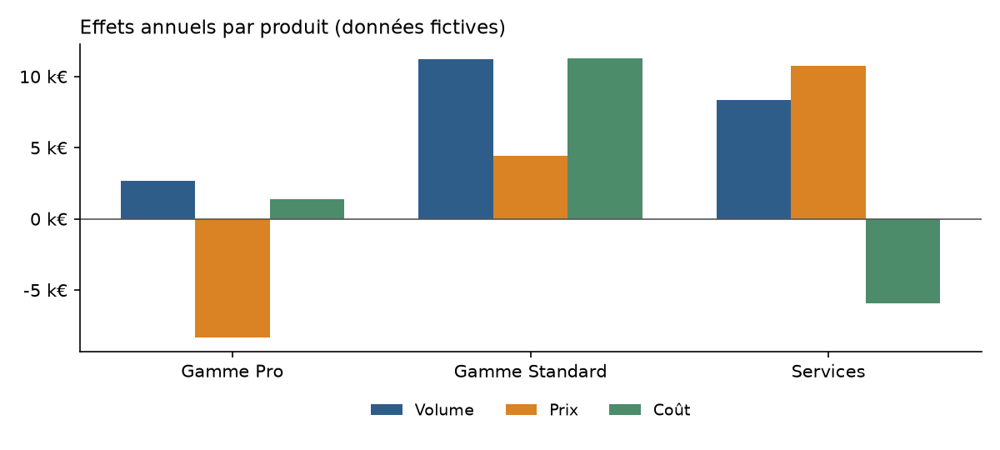

# Budget vs réalisé : pourquoi la marge s'écarte du budget

Projet personnel de Darelle SIDJE (finance d'entreprise, contrôle de gestion).
**Toutes les données sont fictives** : l'entreprise « Atelier Démo SAS » est inventée et la graine aléatoire est fixe. Le projet démontre une méthode d'analyse, pas des résultats réels.

## Question posée
Sur une année, la marge réalisée dépasse le budget de quelques dizaines de milliers d'euros. D'où vient cet écart : de **combien** on a vendu (volume), de **à quel prix** (prix) ou de **ce que ça a coûté** (coût) ? Et sur quels produits et quels mois ?

## Méthode
Pour chaque produit et chaque mois, l'écart de marge est décomposé en trois effets. Convention : un écart favorable est positif.

| Effet | Formule |
|---|---|
| Volume | (volume réel − volume budget) × marge unitaire budget |
| Prix | (prix réel − prix budget) × volume réel |
| Coût | (coût unitaire budget − coût unitaire réel) × volume réel |

La somme des trois effets est égale à l'écart total de marge. Un contrôle le vérifie à chaque calcul (`analyse_ecarts.py`) et des tests le vérifient aussi (`tests/`).

## Résultats sur le jeu de données fictif
| | Montant |
|---|---|
| Marge budget | 1 233 225 € |
| Marge réelle | 1 269 081 € |
| **Écart total** | **+35 856 € (+2,9 %)** |
| dont effet volume | +22 257 € |
| dont effet prix | +6 815 € |
| dont effet coût | +6 783 € |

Lecture (sur ces données fictives) :
- L'écart favorable vient surtout du **volume**, pas du prix ni du coût.
- **Gamme Standard** (+26 977 €) porte l'année, grâce au volume et à des coûts unitaires plus bas.
- **Services** (+13 187 €) gagne sur le prix et le volume, mais perd 5 907 € sur le coût.
- **Gamme Pro** (−4 308 €) est le seul produit défavorable : le prix réel est trop bas (−8 360 €).
- **Juillet** est le mois le plus défavorable (−12 480 €, essentiellement à cause du prix) et **juin** le plus favorable (+10 998 €).





## Contenu du dossier
| Fichier | Rôle |
|---|---|
| `generate_data.py` | Génère `data/budget_vs_realise.csv` (3 produits × 12 mois, graine fixe) |
| `analyse_ecarts.py` | Calcule les effets et produit `data/ecarts_par_produit.csv` |
| `generer_graphiques.py` | Trace les trois graphiques dans `captures/` |
| `tests/test_ecarts.py` | Tests de la décomposition (exemple calculé à la main, signes, cohérence du jeu complet) |
| `powerbi/mesures.dax` | Mesures DAX pour le tableau de bord |

## Reproduire
```bash
pip install -r requirements.txt
python generate_data.py
python analyse_ecarts.py
python generer_graphiques.py
python -m pytest tests/ -v
```

## Tableau de bord Power BI (en cours)
Le fichier `.pbix` n'est pas encore publié. Les mesures sont prêtes dans `powerbi/mesures.dax`. Plan des pages :
1. **Vue d'ensemble** : cartes (marge budget, marge réelle, écart total, écart en %) et cascade des trois effets.
2. **Détail par produit** : histogramme groupé des effets et tableau.
3. **Suivi mensuel** : tableau avec mise en forme conditionnelle (mesure `Couleur écart`) et courbe de l'écart cumulé.

## Limites
- Données synthétiques : les écarts sont tirés au hasard autour du budget.
- Pas d'effet de mix produit (les trois produits sont suivis séparément), pas de charges fixes, pas de centres de coûts.
- L'effet volume est valorisé à la marge unitaire du budget, et les effets prix et coût au volume réel : c'est une convention courante, pas la seule.

## Pistes
- Ajouter une version avec effet de mix lorsque plusieurs références partagent un même marché.
- Remplacer les données fictives par un export anonymisé d'un ERP pour tester le même calcul.
